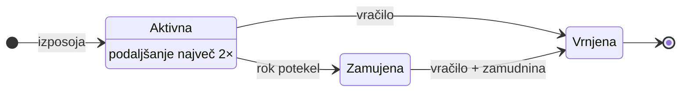
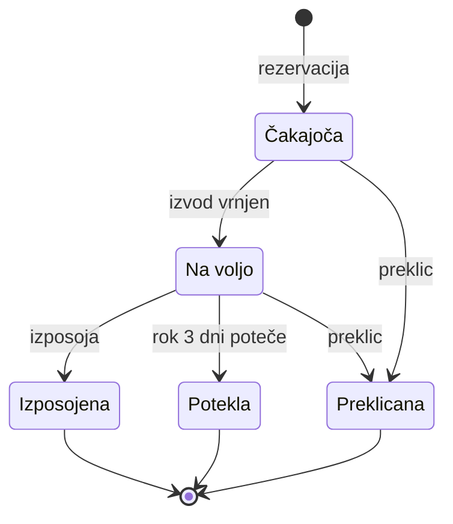

# 02 – Funkcionalnost in obseg

## 1. Uporabniške vloge

### Bralec

**Lahko:**
- išče po katalogu in vidi razpoložljivost izvodov,
- rezervira izposojeno knjigo in se uvrsti v čakalno vrsto,
- preklice svojo rezervacijo,
- vidi svoje izposoje, roke vrnitve, rezervacije in zamudnine,
- podaljša svojo izposojo (če pravila to dovoljujejo),
- ureja svoj profil (kontaktni podatki, geslo).

**Nima pravic:**
- evidentirati izposoje in vračila,
- urejati kataloga,
- videti podatkov drugih članov,
- odpustiti zamudnine ali blokirati članov.

### Knjižničar

**Lahko:**
- evidentira izposojo in vračilo za katerega koli člana,
- ureja katalog (knjige, avtorji, izvodi),
- registrira nove člane in upravlja njihove račune (blokada, odblokada),
- vidi seznam zamudnikov in odpusti zamudnino (z obrazložitvijo),
- vidi vse izposoje in rezervacije.

**Nima pravic:**
- spreminjati uporabniških vlog (npr. imenovati drugega knjižničarja),
- spreminjati sistemskih pravil (rok izposoje, višina zamudnine),
- videti sistemske statistike in poročil,
- brisati zgodovine izposoj.

### Administrator

**Lahko:**
- dodeljuje in odvzema uporabniške vloge,
- nastavlja pravila izposoje (rok, zamudnina, največ izposoj, rok prevzema rezervacije),
- vidi statistiko (najbolj izposojene knjige, število zamud, aktivni člani),
- ima vpogled v vse podatke.

**Nima pravic:**
- ni namenjen vsakodnevni izposoji (to opravlja knjižničar),
- ne more spreminjati ali brisati zgodovine že zaključenih izposoj (revizijska sled),
- ne vidi gesel uporabnikov (shranjena so samo zgoščena).
zemljevid, goodreads
---

## 2. Predvidene funkcionalnosti

Funkcionalnosti označene z **(MVP)** so del prve delujoče različice. Domensko specifične so označene z **[domensko]**.

| # | Funkcionalnost | Opis | Vloga |
|---|---|---|---|
| 1 | **(MVP)** Prijava, registracija in vloge | Prijava z e-pošto in geslom. Sistem pozna tri vloge, ki določajo dostop do funkcij. | vsi |
| 2 | **(MVP)** Iskanje po katalogu z razpoložljivostjo | Iskanje po naslovu, avtorju, žanru in ISBN. Ob vsakem naslovu je prikazano število prostih izvodov in dolžina čakalne vrste. | bralec, knjižničar |
| 3 | **(MVP)** Izposoja z preverjanjem pravil **[domensko]** | Pri izposoji sistem preveri: član ni blokiran, ima manj kot 5 aktivnih izposoj, nima neplačane zamudnine nad mejo, izvod je prost ali rezerviran za tega člana. Rok vrnitve se nastavi na 21 dni. | knjižničar |
| 4 | **(MVP)** Vračilo in samodejni izračun zamudnine **[domensko]** | Ob vračilu sistem primerja datum z rokom in obračuna zamudnino (privzeto 0,10 € na dan zamude). Izvod se vrne v katalog ali gre naprej v čakalno vrsto. | knjižničar |
| 5 | **(MVP)** Rezervacija in čakalna vrsta **[domensko]** | Za naslov, ki nima prostega izvoda, se bralec uvrsti v vrsto po vrstnem redu rezervacije. Ob vračilu izvod samodejno pripade prvemu v vrsti za 3 dni. | bralec |
| 6 | **(MVP)** Pregled mojih izposoj, rezervacij in zamudnin | Bralec vidi aktivne izposoje z roki, položaj v čakalni vrsti, rezervacije z rokom prevzema in neplačane zamudnine. | bralec |
| 7 | **(MVP)** Upravljanje kataloga | Dodajanje, urejanje in brisanje knjig, avtorjev in fizičnih izvodov (z inventarno številko). | knjižničar |
| 8 | Podaljšanje izposoje **[domensko]** | Izposojo je mogoče podaljšati največ 2-krat po 7 dni. Podaljšanje ni mogoče, če ima naslov čakalno vrsto ali je izposoja že zamujena. | bralec |
| 9 | Samodejni potek neprevzete rezervacije **[domensko]** | Planirano opravilo vsak dan preveri rezervacije v stanju *Na voljo*. Če rok prevzema poteče, se rezervacija zapre in izvod pripade naslednjemu v vrsti ali se sprosti. | sistem |
| 10 | Seznam zamudnikov in odpust zamudnine | Knjižničar vidi člane z zamujenimi izposojami in neplačanimi zamudninami, lahko zamudnino označi za plačano ali jo odpusti z obrazložitvijo. | knjižničar |
| 11 | Blokada člana | Član z previsoko neplačano zamudnino ali kršitvami je blokiran in ne more izposojati ali rezervirati, dokler ni odblokiran. | knjižničar |
| 12 | Ocene in komentarji bralcev | Bralec lahko oceni knjigo (1–5) in napiše kratek komentar, če jo je že izposodil. | bralec |
| 13 | Seznam želja | Bralec shrani naslove, ki jih želi prebrati kasneje, in z enim klikom rezervira naslov s seznama. | bralec |
| 14 | Statistika knjižnice | Najbolj izposojene knjige, število zamud na mesec, najaktivnejši člani, povprečna dolžina čakalne vrste. | administrator |
| 15 | Nastavljanje pravil izposoje | Administrator spreminja parametre (rok izposoje, zamudnina, največ izposoj, rok prevzema) brez posega v kodo. | administrator |
| 16 | Zemljevid knjižnice **[zunanje]** | Stran *O knjižnici* prikaže lokacije knjižnice na zemljevidu OpenStreetMap. Ob vsaki lokaciji so naslov, odpiralni čas in povezava za odprtje na openstreetmap.org. Lokacije vnaša administrator. | vsi, tudi neprijavljeni |
| 17 | Povezava na Goodreads **[zunanje]** | Na strani knjige je povezava, ki odpre knjigo na Goodreads po ISBN, kjer bralec najde ocene in mnenja drugih bralcev. Podatki z Goodreads se v Librarium ne prenašajo. | bralec |
| 18 | Uvoz podatkov in naslovnic po ISBN **[zunanje]** | Ko knjižničar pri dodajanju knjige vnese ISBN, sistem iz Open Library predizpolni naslov, avtorje, leto izida, število strani in naslovnico. Knjižničar podatke preveri in shrani. | knjižničar |
| 19 | Obvestila po e-pošti **[zunanje]** | Sistem prek zunanjega ponudnika e-pošte pošlje opomnik 3 dni pred rokom vrnitve, obvestilo, ko je rezervirana knjiga na voljo, in obvestilo ob zamudi. Bralec lahko obvestila izklopi. | bralec |
---

## 3. Ključni delovni proces: vračilo knjige in čakalna vrsta

To je netrivialen delovni proces, ki povezuje funkcionalnosti 3, 4, 5 in 9. Jedro je stroj stanj, ki ga vodi backend v eni podatkovni transakciji.

**Stanja izposoje:**

**Stanja rezervacije:**

**Potek ob vračilu:**
1. Knjižničar označi izvod kot vrnjen. Sistem zapre izposojo in po potrebi obračuna zamudnino.
2. Sistem poišče najstarejšo rezervacijo v stanju *Čakajoča* za ta naslov.
3. Če obstaja, jo prestavi v *Na voljo*, nastavi rok prevzema na 3 dni in izvod označi kot *Rezerviran*. Če ne obstaja, izvod postane *Prost*.
4. Če rezervacija v 3 dneh ni izposojena, planirano opravilo nastavi *Potekla* in korak 2 se ponovi za naslednjega v vrsti.

**Poslovna pravila** (vse vrednosti so nastavljive, funkcionalnost 15):

| Pravilo | Privzeta vrednost |
|---|---|
| Največ aktivnih izposoj na člana | 5 |
| Rok izposoje | 21 dni |
| Največ podaljšanj | 2 (po 7 dni) |
| Zamudnina | 0,10 € na dan zamude |
| Blokada izposoje ob neplačani zamudnini nad | 5,00 € |
| Največ aktivnih rezervacij na člana | 3 |
| Rok prevzema rezervirane knjige | 3 dni |
| Isti naslov hkrati | član ne more imeti dveh aktivnih rezervacij ali izposoj istega naslova |

---

## 4. Kasnejše nadgradnje

- **Obvestila po e-pošti:** opomnik pred iztekom roka, obvestilo, ko je rezervirana knjiga na voljo, in obvestilo ob zamudi.
- **Priporočila knjig** na podlagi zgodovine izposoj in ocen.
- **Črtne ali QR kode** na izvodih za hitro izposojo in vračilo.
- **Spletno plačilo zamudnine** prek zunanjega ponudnika plačil.
- **Mobilna aplikacija ali PWA** z obvestili.
- **Uvoz podatkov o knjigah po ISBN** iz zunanjih virov (npr. Open Library).

---

## 5. Izven obsega (Out of scope)

- Branje e-knjig in zvočnih knjig v brskalniku.
- Integracija z obstoječimi knjižničnimi sistemi (npr. COBISS).
- Upravljanje zaposlenih, delovnih časov in plač.
- Nabava novih knjig, dobavitelji in računovodstvo.
- Organizacija dogodkov in prostorov (bralni klubi, delavnice, rezervacija čitalnic).
- Samopostrežna izposoja z RFID oznakami in avtomati.
- Večjezični uporabniški vmesnik (aplikacija je samo v slovenščini).
