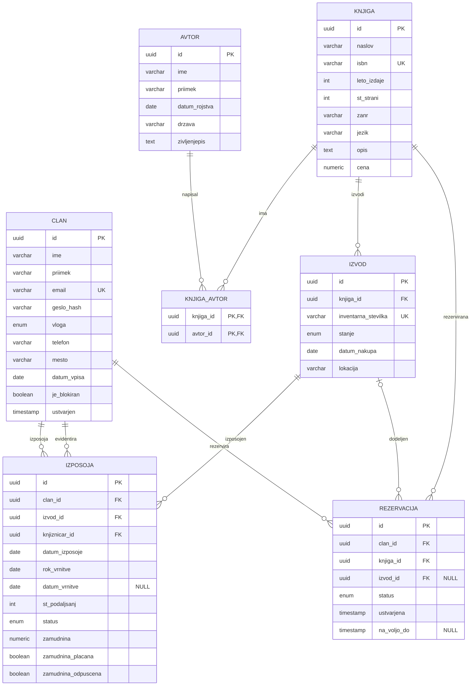

# 03 – Podatkovni model

Podatkovni model je relacijski. Pravila izposoje in čakalne vrste se močno opirajo na povezave med entitetami in transakcije, zato je relacijska zasnova naravna izbira. Imena tabel in polj so zapisana brez šumnikov (snake_case).

## 1. Pregled entitet

| Entitet | Opis |
|---|---|
| `clan` | uporabnik sistema (bralec, knjižničar ali administrator), vloga je polje v tabeli |
| `avtor` | avtor knjige |
| `knjiga` | naslov v katalogu (bibliografski podatki) |
| `knjiga_avtor` | vmesna tabela za povezavo N:M med knjigami in avtorji |
| `izvod` | konkreten fizični izvod knjige z inventarno številko |
| `izposoja` | zapis o izposoji izvoda s strani člana |
| `rezervacija` | rezervacija naslova s strani člana (vrstni red določa čakalno vrsto) |
| `nastavitev` | pomožna tabela za nastavljiva pravila izposoje |

## 2. Diagram (ER)

## 3. Povezave med entitetami

- **Avtor ↔ Knjiga: N:M** (knjiga ima lahko več avtorjev, avtor več knjig) prek `knjiga_avtor`.
- **Knjiga → Izvod: 1:N** (en naslov ima več fizičnih izvodov).
- **Clan → Izposoja: 1:N** in **Izvod → Izposoja: 1:N** (izvod ima skozi čas več izposoj, naenkrat samo eno aktivno).
- **Clan → Rezervacija: 1:N** in **Knjiga → Rezervacija: 1:N** (rezervacija se nanaša na naslov, ne na izvod).
- **Izvod → Rezervacija: 0..1:N** (izvod se rezervaciji dodeli šele, ko postane *Na voljo*).
- **Clan → Izposoja (knjižničar):** polje `knjiznicar_id` v izposoji kaže na člana z vlogo knjižničar, ki je izposojo evidentiral.

## 4. Opis entitet in glavnih polj

### `clan`

| Polje | Tip | Opis |
|---|---|---|
| `id` | UUID, PK | |
| `ime`, `priimek` | VARCHAR | |
| `email` | VARCHAR, unikaten | uporablja se za prijavo |
| `geslo_hash` | VARCHAR | zgoščeno geslo |
| `vloga` | ENUM (`bralec`, `knjiznicar`, `admin`) | določa pravice |
| `telefon`, `mesto` | VARCHAR | kontaktni podatki |
| `datum_vpisa` | DATE | |
| `je_blokiran` | BOOLEAN | blokiran član ne more izposojati ali rezervirati |
| `ustvarjen` | TIMESTAMP | |

### `avtor`

| Polje | Tip | Opis |
|---|---|---|
| `id` | UUID, PK | |
| `ime`, `priimek` | VARCHAR | |
| `datum_rojstva` | DATE | |
| `drzava` | VARCHAR | |
| `zivljenjepis` | TEXT | kratek opis |

### `knjiga`

| Polje | Tip | Opis |
|---|---|---|
| `id` | UUID, PK | |
| `naslov` | VARCHAR | |
| `isbn` | VARCHAR, unikaten | |
| `leto_izdaje` | INT | |
| `st_strani` | INT | |
| `zanr` | VARCHAR | |
| `jezik` | VARCHAR | |
| `opis` | TEXT | |
| `cena` | NUMERIC(8,2) | nadomestilo ob izgubi |

### `knjiga_avtor`

| Polje | Tip | Opis |
|---|---|---|
| `knjiga_id` | UUID, FK → `knjiga` | del sestavljenega ključa |
| `avtor_id` | UUID, FK → `avtor` | del sestavljenega ključa |

### `izvod`

| Polje | Tip | Opis |
|---|---|---|
| `id` | UUID, PK | |
| `knjiga_id` | UUID, FK → `knjiga` | |
| `inventarna_stevilka` | VARCHAR, unikaten | |
| `stanje` | ENUM (`prost`, `izposojen`, `rezerviran`, `izgubljen`) | trenutno stanje izvoda |
| `datum_nakupa` | DATE | |
| `lokacija` | VARCHAR | polica ali oddelek |

### `izposoja`

| Polje | Tip | Opis |
|---|---|---|
| `id` | UUID, PK | |
| `clan_id` | UUID, FK → `clan` | kdo si je izposodil |
| `izvod_id` | UUID, FK → `izvod` | kaj je izposodil |
| `knjiznicar_id` | UUID, FK → `clan` | kdo je izposojo evidentiral |
| `datum_izposoje` | DATE | |
| `rok_vrnitve` | DATE | |
| `datum_vrnitve` | DATE, NULL | prazno, dokler ni vrnjeno |
| `st_podaljsanj` | INT | največ 2 |
| `status` | ENUM (`aktivna`, `zamujena`, `vrnjena`) | |
| `zamudnina` | NUMERIC(8,2) | obračunan znesek |
| `zamudnina_placana` | BOOLEAN | |
| `zamudnina_odpuscena` | BOOLEAN | odpustil knjižničar |

### `rezervacija`

| Polje | Tip | Opis |
|---|---|---|
| `id` | UUID, PK | |
| `clan_id` | UUID, FK → `clan` | |
| `knjiga_id` | UUID, FK → `knjiga` | rezerviran naslov |
| `izvod_id` | UUID, FK → `izvod`, NULL | dodeljen šele, ko je rezervacija *Na voljo* |
| `status` | ENUM (`cakajoca`, `na_voljo`, `izposojena`, `potekla`, `preklicana`) | |
| `ustvarjena` | TIMESTAMP | določa položaj v čakalni vrsti |
| `na_voljo_do` | TIMESTAMP, NULL | rok prevzema (3 dni po prehodu v *Na voljo*) |

Položaj v čakalni vrsti ni shranjen, ampak se izračuna iz vrstnega reda `ustvarjena` med rezervacijami istega naslova v stanju *Čakajoča*. S tem preprečimo težave s ponovnim številčenjem ob preklicu.

### `nastavitev`

| Polje | Tip | Opis |
|---|---|---|
| `kljuc` | VARCHAR, PK | npr. `rok_izposoje_dni`, `zamudnina_na_dan` |
| `vrednost` | VARCHAR | |

## 5. Omejitve

- **Samo ena aktivna izposoja na izvod:** unikatna omejitev na `izvod_id` za vrstice, kjer `status` ni `vrnjena`.
- **Član ne more imeti dveh aktivnih rezervacij istega naslova:** unikatna omejitev na (`clan_id`, `knjiga_id`) za rezervacije v stanju `cakajoca` ali `na_voljo`.
- **Preverjanje vrednosti:** `st_podaljsanj` med 0 in 2, `rok_vrnitve` ≥ `datum_izposoje`.
- **Transakcije:** izposoja, vračilo in prehod rezervacije se izvedejo v eni transakciji, da ne pride do dvojne izposoje istega izvoda.
