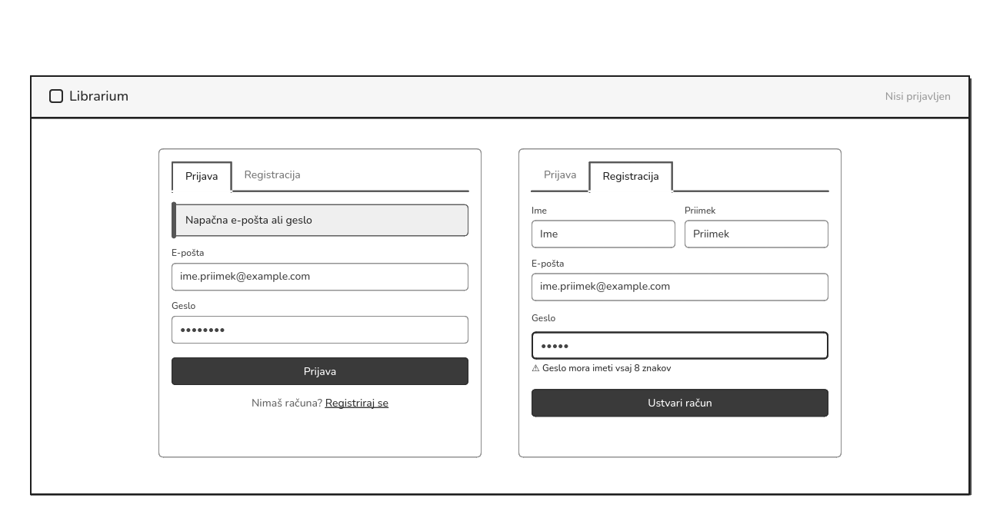
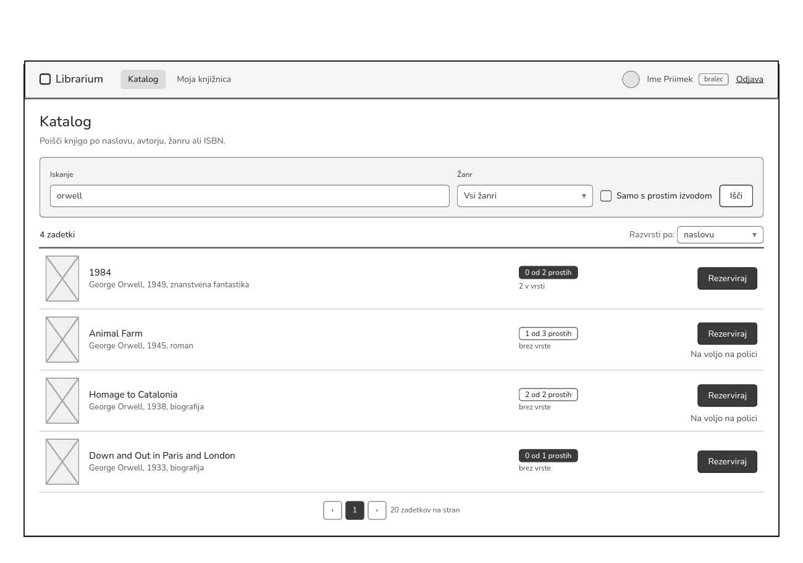
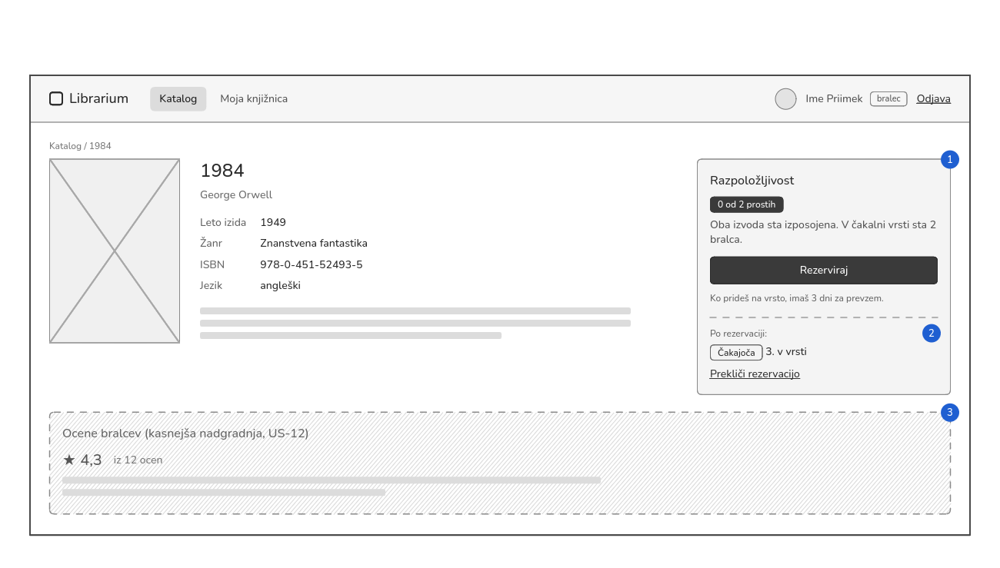
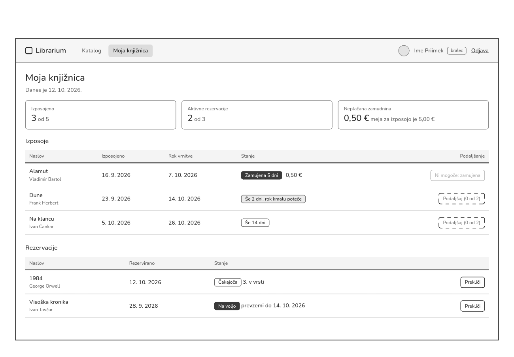
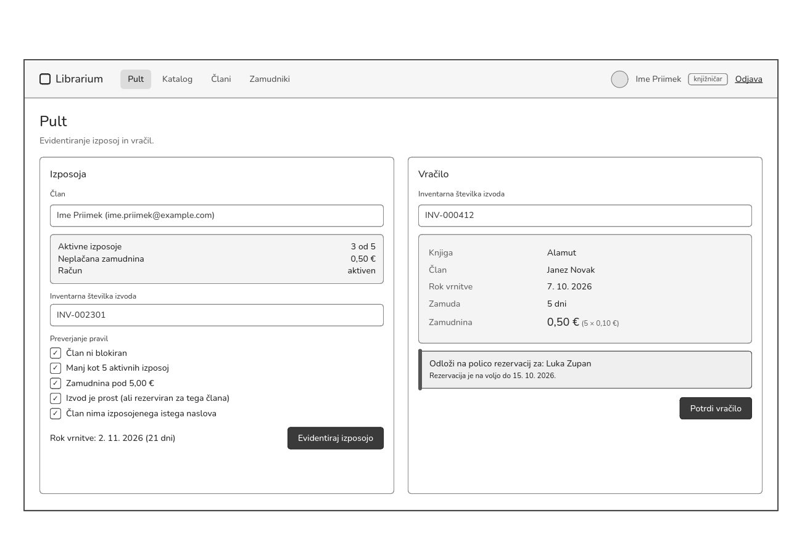
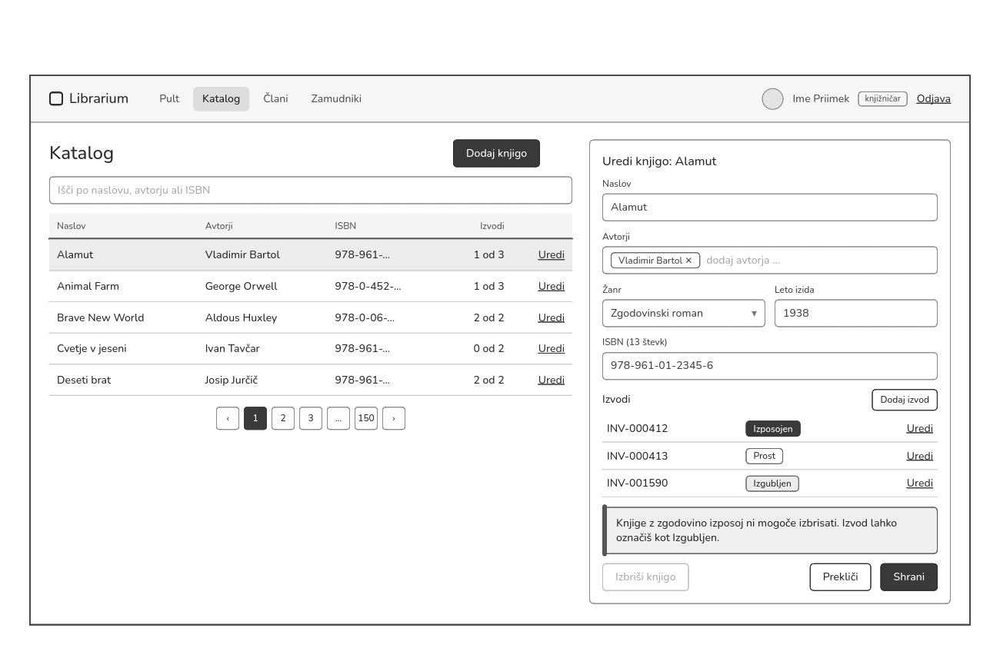

# 05 – Wireframes

Wireframe-i prikazujejo osnovni izgled glavnih zaslonov prve delujoče različice (MVP). So nizke ločljivosti in sivinski, ker prikazujejo razporeditev vsebine in potek dela, ne pa končnega oblikovanja (barv, pisav, ikon).

| Wireframe | Zaslon | Vloga | Uporabniške zgodbe |
|---|---|---|---|
| [WF01](#WF01--prijava-in-registracija) | Prijava in registracija | vsi | US-01 |
| [WF02](#WF02--katalog-in-iskanje) | Katalog in iskanje | bralec | US-02, US-05 |
| [WF03](#WF03--podrobnosti-knjige-in-rezervacija) | Podrobnosti knjige in rezervacija | bralec | US-02, US-05, US-12 |
| [WF04](#WF04--moja-knjižnica) | Moja knjižnica | bralec | US-06, US-05, US-08 |
| [WF05](#WF05--pult-knjižničarja-izposoja-in-vračilo) | Pult: izposoja in vračilo | knjižničar | US-03, US-04 |
| [WF06](#WF06--upravljanje-kataloga) | Upravljanje kataloga | knjižničar | US-07 |

---

## WF01 – Prijava in registracija

Slika: [`wireframes/login-register.png`](wireframes/login-register.png)

Vstopna stran za neprijavljene uporabnike. Prijava in registracija sta zavihka iste strani. Na sliki sta prikazana oba, vsak s primerom napake.

1. **Prijava** z e-pošto in geslom. Ob napačnih podatkih je izpisano splošno sporočilo »Napačna e-pošta ali geslo«, ki ne razkrije, kateri podatek je napačen (US-01, kriterij 4).
2. **Registracija** z imenom, priimkom, e-pošto in geslom (US-01, kriterij 1).
3. **Napaka ob polju:** geslo je krajše od 8 znakov, zato je polje poudarjeno in pod njim je razlog (US-01, kriterij 1).
4. **Vloga novega računa:** nov račun vedno dobi vlogo *bralec* (US-01, kriterij 3).

## WF02 – Katalog in iskanje

Slika: [`wireframes/katalog.png`](wireframes/katalog.png)

Glavna stran bralca. Bralec išče po katalogu in pri vsakem zadetku takoj vidi, ali je knjiga prosta ali jo mora rezervirati. Meni prijavljenega bralca ima samo *Katalog* in *Moja knjižnica*.

1. **Iskanje** po naslovu, avtorju ali ISBN (US-02, kriterij 1).
2. **Filtra** *žanr* in *samo s prostim izvodom*, ki se kombinirata z iskalnim nizom (US-02, kriterij 2).
3. **Skupno število zadetkov** nad seznamom (US-02, kriterij 4).
4. **Razpoložljivost:** prosti izvodi od vseh in dolžina čakalne vrste (US-02, kriterij 3).
5. **Rezerviraj** je prikazan pri naslovih brez prostega izvoda kot tudi z izvodom, pri teh tudi piše »Na voljo na polici« (US-05, kriterij 1).
6. **Ostranjevanje** po 20 zadetkov (US-02, kriterij 4).

## WF03 – Podrobnosti knjige in rezervacija

Slika: [`wireframes/podrobnosti.png`](wireframes/podrobnosti.png)

Stran knjige s podatki, razpoložljivostjo in rezervacijo. Prikazana je knjiga, ki nima prostega izvoda.

1. **Razpoložljivost:** oba izvoda sta izposojena, v vrsti sta 2 bralca. Ob gumbu *Rezerviraj* je pojasnilo, da ima bralec 3 dni za prevzem (US-02, kriterij 3; US-05, kriterij 1).
2. **Stanje po rezervaciji:** rezervacija *Čakajoča* in položaj »3. v vrsti« ter povezava za preklic (US-05, kriterija 2 in 5).
3. **Ocene bralcev:** kasnejša nadgradnja, ni del MVP (US-12).

## WF04 – Moja knjižnica

Slika: [`wireframes/moja-knjiznica.png`](wireframes/moja-knjiznica.png)

Pregled vsega, kar ima bralec pri knjižnici: izposoje, rezervacije in zamudnine.

1. **Neplačana zamudnina** in meja 5,00 €, nad katero izposoja ni mogoča. Zraven sta števca izposoj (3 od 5) in rezervacij (2 od 3) (US-06, kriterij 4).
2. **Izposoje** z datumom izposoje, rokom in stanjem (US-06, kriteriji 1 in 2):
   - zamujena izposoja ima število dni zamude in trenutno zamudnino (5 dni × 0,10 € = 0,50 €),
   - izposoja z rokom v 3 dneh je označena »Rok kmalu poteče«.
3. **Podaljšaj** Pri zamujeni izposoji ni mogoč (US-08, kriteriji 1, 2 in 4).
4. **Rezervacije** s stanjem (US-06, kriterij 3; US-05, kriterij 5):
   - *Čakajoča* s položajem v vrsti,
   - *Na voljo* z datumom, do katerega jo je treba prevzeti,
   - pri obeh je gumb za preklic.

## WF05 – Pult knjižničarja: izposoja in vračilo

Slika: [`wireframes/pult.png`](wireframes/pult.png)

Delovno mesto knjižničarja za oba ključna procesa. Izposoja in vračilo sta na istem zaslonu, ker ju knjižničar za pultom pogosto izmenjuje. Meni knjižničarja ima *Pult*, *Katalog*, *Člani* in *Zamudniki*.

1. **Izbira člana** po imenu ali e-pošti. Pod poljem je povzetek člana: aktivne izposoje, neplačana zamudnina in stanje računa (US-03, kriterij 1).
2. **Preverjanje pravil** pred potrditvijo (US-03, kriteriji 2–4): član ni blokiran, ima manj kot 5 izposoj in zamudnino pod 5,00 €, izvod je prost ali rezerviran zanj, istega naslova še nima izposojenega.
3. **Rok vrnitve** se izračuna samodejno: 12. 10. 2026 + 21 dni = 2. 11. 2026 (US-03, kriterij 1).
4. **Primer zavrnitve** z razlogom, ko pravilo ni izpolnjeno (US-03, kriterij 2).
5. **Vračilo** z vnosom inventarne številke (US-04, kriterij 1).
6. **Obračun zamudnine:** član, knjiga, rok, dni zamude in znesek (5 × 0,10 € = 0,50 €) (US-04, kriterija 1 in 2).
7. **Kam z izvodom:** naslov ima čakalno vrsto, zato sistem izvod dodeli prvemu v vrsti in izpiše, na katero polico ga odložiti in do kdaj velja rezervacija (12. 10. + 3 dni) (US-04, kriterij 3).

## WF06 – Upravljanje kataloga

Slika: [`wireframes/upravljanje.png`](wireframes/upravljanje.png)

Knjižničar ureja katalog: na levi je seznam knjig, na desni plošča za urejanje izbrane knjige.

1. **Dodaj knjigo** odpre isto ploščo s praznim obrazcem (US-07, kriterij 1).
2. **Urejanje knjige:** naslov, avtorji (eden ali več), žanr, leto izida in ISBN s 13 števkami (US-07, kriterij 1).
3. **Izvodi knjige** z inventarno številko in stanjem. Nov izvod se doda z gumbom *Dodaj izvod* (US-07, kriterij 2).
4. **Brisanje ni mogoče**, ker ima knjiga zgodovino izposoj. Gumb *Izbriši knjigo* je onemogočen, sporočilo pa predlaga, naj se izvod označi kot *Izgubljen* (US-07, kriterij 3).
